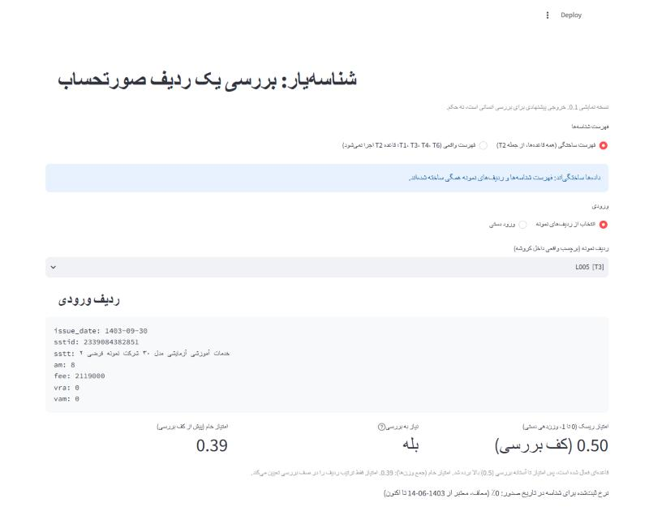
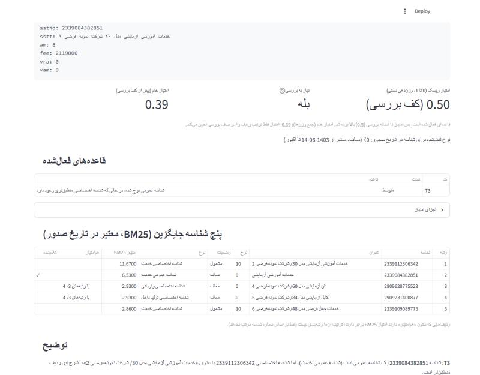
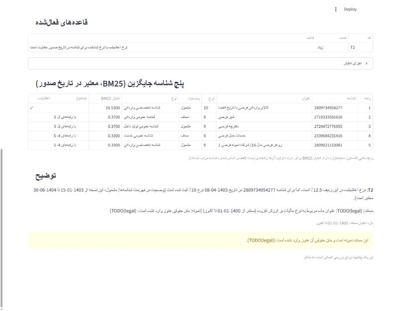

# Shenaseyar (شناسه‌یار) v0.1 demo

<div dir="rtl">

**خلاصه.** شناسه‌یار هر ردیف صورتحساب الکترونیکی سامانه مودیان را بررسی می‌کند تا ناهمخوانی میان شرح کالا یا خدمت، شناسه ۱۳ رقمی اعلام‌شده و نرخ اعلام‌شده را پیدا کند. خروجی یک پیشنهاد برای بررسی انسانی است، نه حکم. این نسخه یک نمونه نمایشی است: همه اعداد زیر روی داده ساختگی اندازه‌گیری شده‌اند، مجموعه ارزیابی دست‌ساز هنوز ساخته نشده است و هیچ متن حقوقی هنوز وارد نشده است.

</div>

## What it does
Shenaseyar checks one line of a Persian e-invoice (Iran's سامانه مودیان) for mismatches between the
free-text description (`sstt`), the declared 13-digit product/service ID (`sstid`) and the declared
VAT rate (`vra`), using deterministic rules plus BM25 retrieval over the product-ID catalog.
Each flagged line gets a transparent hand-weighted score that orders a review queue, five
alternative IDs, and a short Persian template explanation.
The output is a suggestion for human review, never a verdict.

Design: `docs/architecture.md`. Full demo report with every number and caveat: `docs/demo.md`.

## How to run
Python 3.12 (tested on CPython 3.12.8, Windows 11). CPU only, no network access at runtime.

```bash
python -m venv .venv
```
```bash
source .venv/Scripts/activate        # Git Bash on Windows; Linux/macOS: source .venv/bin/activate
```
```bash
pip install -r requirements-demo.lock.txt     # exact versions v0.1 was tested with
```
```bash
streamlit run app.py
```

The page opens on the **fake** profile (an invented 50-row catalog and 200 committed synthetic
lines). The **real** profile appears only if you put the manually downloaded catalog zip in
`data/catalog/` and generate its lines with `python tools/make_demo_invoices.py --profile real`.
The catalog is obtained by manual download only and is never committed.

Tests and the rule evaluation:
```bash
pytest -q
```
```bash
python tools/eval_demo_rules.py               # add --profile real for the real catalog
```

### Screenshots (fake profile)
A T3 line: the declared ID is a general one while a specific ID matches the text better. The score
is floored at the review threshold because a rule fired; the raw weighted sum is shown next to it.



Fired rules and the five BM25 alternatives valid on the invoice date (ties marked).



A T2 line (declared rate differs from the catalog rate on the invoice date). The citation is a
`TODO(legal)` placeholder: no legal text has been entered.



## MEASURED
Everything in this section is a measured number, reproducible with the commands above. Sources:
`eval/results/demo_rules.json` (fake profile) and `eval/results/demo_rules_real.json` (real profile).

### Results
Every row so far is on **synthetic** lines from our own generator (200 lines per profile, seed 1405,
support 10 per error type). One evaluation set per row block, so a new set (the hand-labeled golden
set) is added as new rows, not as a rewrite.

| Evaluation set | Code | Support | TP | FP | FN | Precision | Recall | Pre-registered bar |
|---|---|---:|---:|---:|---:|---:|---:|---|
| synthetic, fake catalog | T1 | 10 | 4 | 2 | 6 | 0.67 | 0.40 | none |
| synthetic, fake catalog | T2 | 10 | 10 | 0 | 0 | 1.00 | 1.00 | P = R = 1.00: **met** |
| synthetic, fake catalog | T3 | 10 | 10 | 7 | 0 | 0.59 | 1.00 | none |
| synthetic, fake catalog | T4 | 10 | 8 | 0 | 2 | 1.00 | 0.80 | none |
| synthetic, fake catalog | T6 | 10 | 10 | 0 | 0 | 1.00 | 1.00 | P = R = 1.00: **met** |
| synthetic, real catalog (hard T1 set) | T1 | 10 | 3 | 17 | 7 | 0.15 | 0.30 | none |
| synthetic, real catalog (hard T1 set) | T2 | – | – | – | – | not run | not run | (bar is fake-profile only) |
| synthetic, real catalog (hard T1 set) | T3 | 10 | 10 | 0 | 0 | 1.00 | 1.00 | none |
| synthetic, real catalog (hard T1 set) | T4 | 10 | 6 | 0 | 4 | 1.00 | 0.60 | none |
| synthetic, real catalog (hard T1 set) | T6 | 0 | 0 | 0 | 0 | no labels | no labels | (0 firings on 200 lines) |
| hand-labeled golden set | all | not built yet (`eval/golden.csv` has a header and 0 rows) | | | | | | |

Notes on the table:
- **T2 and T6 bar** (precision and recall both 1.00 on the fake profile) was set on 2026-09-28,
  before any rule code. Both rules are arithmetic and lookup, so 1.00 shows they are implemented
  as specified, not that they catch real errors.
- **T1's decision rule** (`rank_declared > 5` and `sim_declared < 0.5`) was pre-registered in
  commit `d96472f`. A **precondition was added afterwards** (2026-10-08), after seeing the first
  run's false alarms: T1 abstains when the description has no word outside T4's vague-word list.
  It raised fake-profile precision from 0.36 to 0.67 (real: 0.09 to 0.15) with recall unchanged
  (0.40 and 0.30). Those precision gains are not an independent result: the precondition was chosen
  on the same lines.
- **Real T1 recall 0.30 is 3 of 10** (95% Wilson interval about 0.11–0.60). Of the 7 misses, 6 fail
  the similarity condition (`sim_declared` 0.51–0.77) and 1 fails the rank condition.
- **Real T1 false positives (17)**: all 10 T3 lines, plus 7 vague-text lines caused by the
  inflection gap (Known limitations). 0 on the 150 non-vague clean lines.
- Fake T3 false positives (7) are all T1 lines whose swapped neighbor is a general ID.
- ID-status flags (`NOT_IN_CATALOG`, `NOT_IN_FORCE`): precision and recall 1.00 on both profiles,
  support 4 each. Hard-flagged lines get no score (8 per profile, 0 scored).
- Retrieval (Phase 1): the golden-set criterion (tier S Recall@5 at least 0.85, measured on no
  fewer than 60 tier S rows) is **not measured**, because the golden set has 0 rows.

**Headline finding:** BM25 alone does not solve T1 on genuinely confusable pairs (3 of 10 on the
hard real set, where the swapped ID is one of the description's own top-20 BM25 matches), which is
why dense retrieval is the designed next step, with its dense-vs-BM25 decision rule already
pre-registered in `docs/silver_set.md`.

### What these numbers are not evidence of
- **Not evidence that any rule catches real errors.** The generator wrote its own labels. It knows
  what the rules look for, and for T1 the generator and the detector share the same notion of
  closeness (BM25 over normalized tokens). No real invoice line has been checked.
- **The hard T1 set is not a random sample.** It is 10 lines drawn from roughly 3% of the catalog:
  336 draws were tried and 326 (97%) were skipped because no ID in the text's top 20 differed in
  `Taxable`. T1 recall there says nothing about the other 97% of the catalog, or about real
  mislabeled lines, which need not come from that slice.
- **Not evidence of precision on real invoices.** The clean lines are catalog titles with light
  noise, not real seller text, so they match their own ID trivially. Seller text is usually
  terser (architecture.md §3: 184 of 300 seller-style queries match 2–20 IDs).
- **The catalog may be truncated** at an export cap: the download has exactly 1,000,000 rows
  (`docs/data_quality.md`). Every real-profile number is provisional until that is resolved.
- **The fake catalog is tiny and invented** (50 rows); its BM25 statistics are nothing like the
  real catalog's.
- **Not evidence about tax consequences.** T1 never reads a rate or a tax status.

## DESIGNED
Everything below is design, not measurement.

### Not built (descoped for v0.1, postponed, not abandoned)
| Component | Why not built | Restarts when |
|---|---|---|
| Dense retrieval (BGE-M3) and the reranker (bge-reranker-v2-m3) | The full index build is about 7.7 h CPU, and no gain over BM25 is shown yet. The index tool exists (`tools/build_dense_index.py`, fp32; int8 failed its pre-registered bar). | `eval/golden.csv` has at least 60 tier S rows. Then build once and apply the pre-registered decision rule in `docs/silver_set.md`. The reranker only if dense or hybrid wins under that rule. |
| LightGBM + SHAP risk model | Replaced by a transparent hand-weighted sum (`src/detect/score.py`); weights hand-set, not learned. | Labeled lines not produced by our own generator exist (real anonymized or hand-labeled), so PR-AUC on a group split means something. |
| Local LLM generation (llama.cpp, Dorna2) and LangGraph | Replaced by Persian templates (`src/detect/explain.py`). | `data/legal/units.json` is filled and reviewed, and rater scores show the templates are too rigid. |
| Citation verifier | With templates every citation is a fixed lookup, so nothing generated needs verifying. | Together with LLM generation. |
| T1 as a learned model | v0.1 has a T1 *rule* over BM25 features; a learned T1 belongs to the risk model. | With the risk model (open framing question, architecture.md §3). |
| T5 (unit price outside the ID group's distribution) | Needs per-group price distributions from real prices; synthetic prices would only test the generator. | Real anonymized invoice lines with prices. |
| Qdrant, PostgreSQL, Redis/RQ, Docker Compose, FastAPI | One process with in-memory tables is enough for a one-line demo. | More than one user, or a batch run too large for memory. |

### Known limitations
- **No hand-labeled evaluation set yet.** `eval/golden.csv` has a header and 0 rows, so every
  number above is on synthetic data.
- **No legal citations populated.** `data/legal/units.json` has the schema and two `TODO(legal)`
  placeholders. Every explanation shows a placeholder citation, and T1 has no unit attached.
- **The catalog's `Vat` column meaning is unresolved** (`TODO(legal)`, `docs/data_dictionary.md`
  §8). T2 therefore runs only on the invented catalog; on the real profile it is reported as
  "not run" and no rate is shown.
- **The inflection gap.** T4's vague-word list holds bare forms, and «کالای» and «رفته» are
  inflected forms missing from it. One limitation, two symptoms: it causes every T4 miss (fake 2,
  real 4) and every T1 false alarm on vague text that survived the precondition (fake 2, real 7).
  The list was deliberately left unchanged in v0.1 (`docs/demo.md`, "Known limitation: the
  inflection gap").
- T1 also fires on every real-profile T3 line (10 of its 17 false positives); whether T1 should
  yield to T3 is an open decision (`docs/demo.md`, Open item 2).

## Data policy
- The product/service ID catalog is obtained by **manual download only** from
  stuffid.tax.gov.ir. This project never automates access to it.
- The catalog file and any large extract of it are **never committed** (copyright). Put it in
  `data/catalog/` (gitignored). Tests use the invented `data/sample/fake_catalog.csv`.
- File layout: `docs/data_dictionary.md`.
